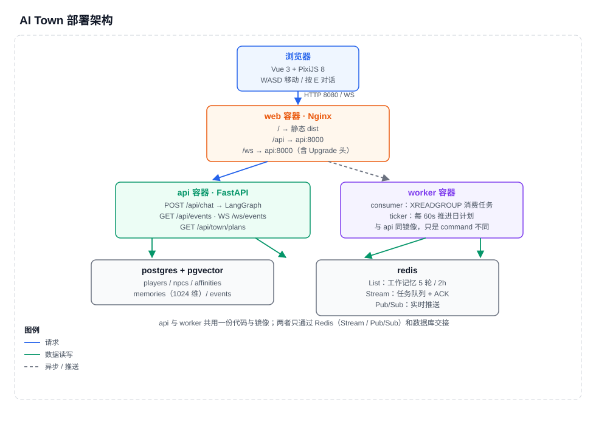
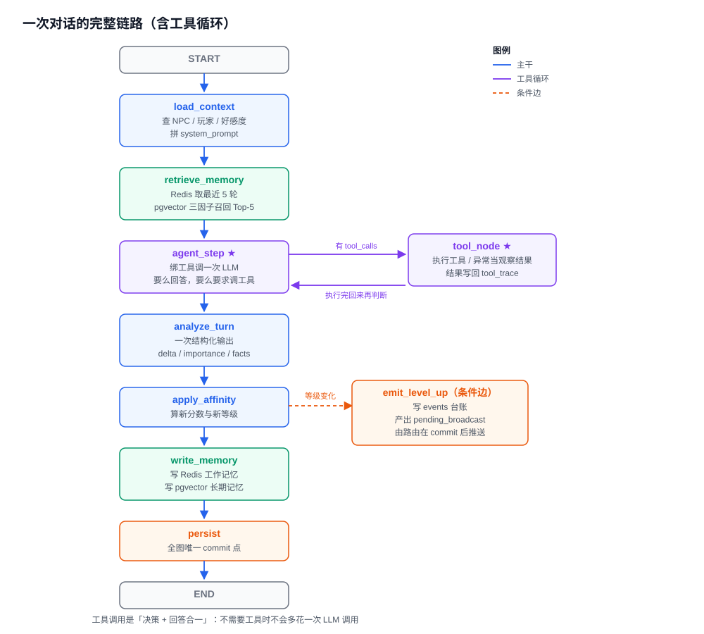
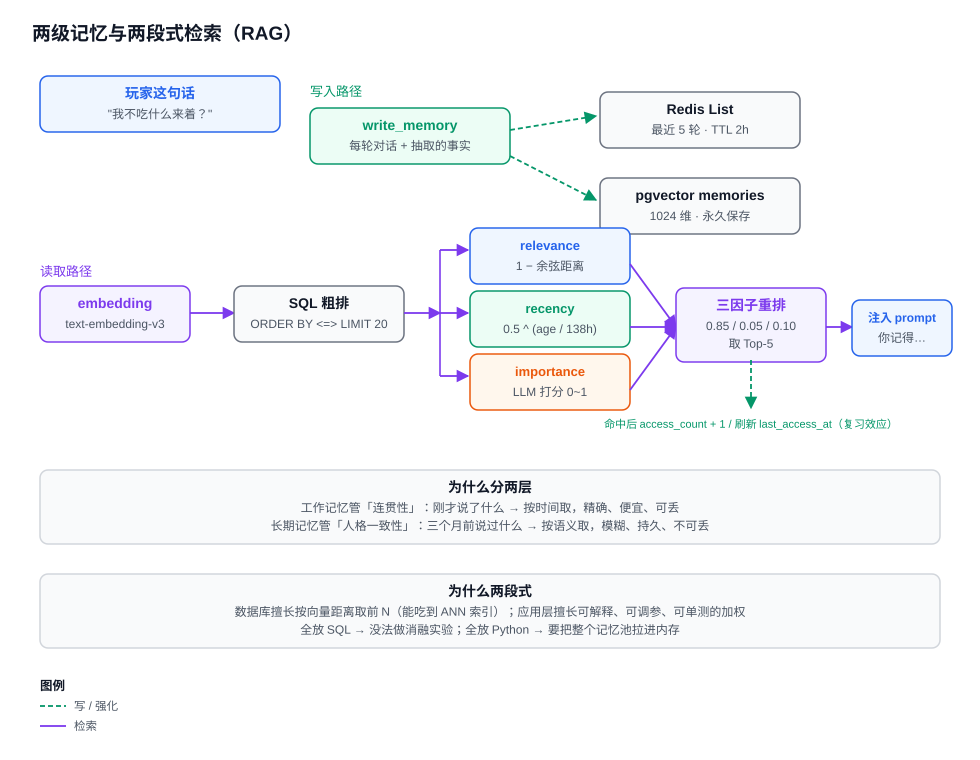
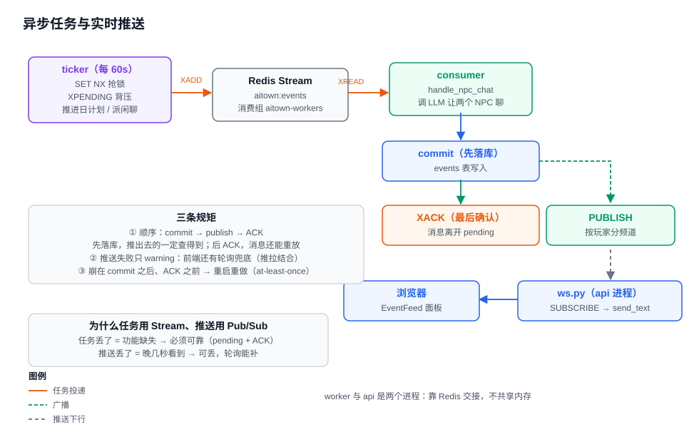
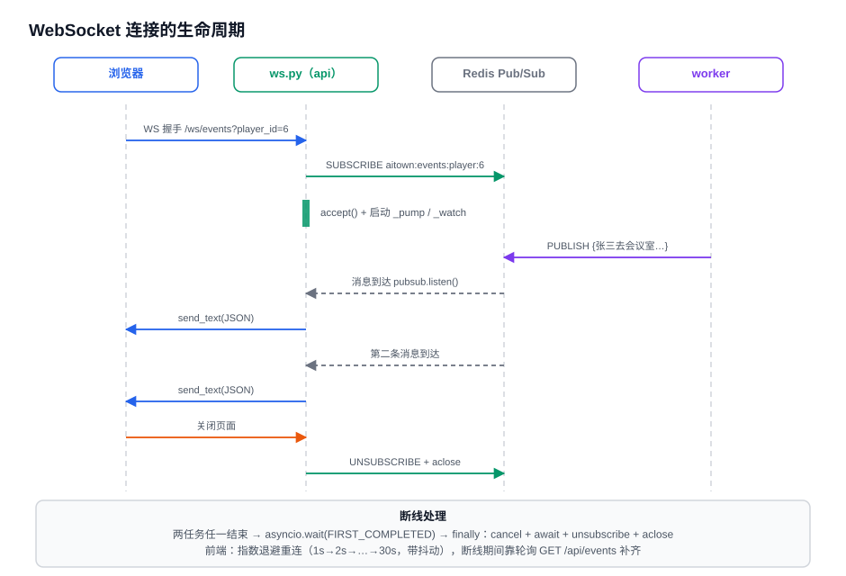
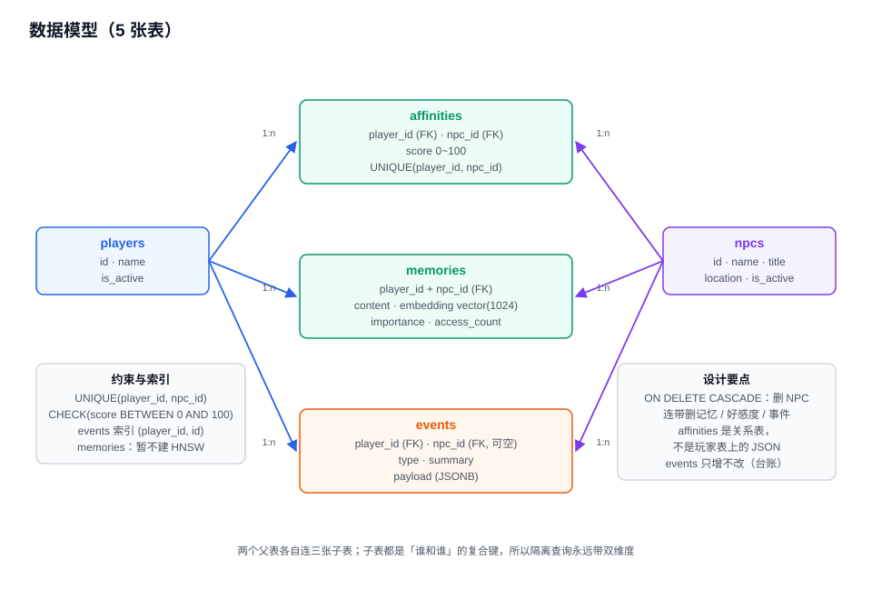

# AI Town · 多智能体小镇

> 一个「多智能体 + 两级记忆 + 工具调用 + 事件驱动」的模拟小镇。
> 3 个 AI NPC 各有独立人设、长期记忆、好感度和**当日计划**；玩家可以走过去和他们聊天，NPC 之间也会自己互动。



**这个项目想证明的不是"我会调 API"，而是"我能把一个 LLM 应用做成工程"。**

| 能力 | 状态 | 对应的知识点 |
|---|---|---|
| 玩家可控移动（WASD）+ 相机跟随 + 像素动画 | ✅ | 游戏循环、坐标系、渲染分层 |
| 走近按 E 对话，LLM 按人设回复 | ✅ | Prompt 工程、降级策略 |
| **工具调用（ReAct 循环）**：查时间 / 查小镇 / 翻记忆 | ✅ | Function Calling、状态机循环、防死循环 |
| **两级记忆**：Redis 工作记忆 + pgvector 长期记忆 | ✅ | 短期/长期记忆、TTL、向量存储 |
| **两段式检索 + 三因子重排** | ✅ | RAG、召回与重排分离、消融实验 |
| **NPC 日计划**：每天生成、到点执行、自动换房间 | ✅ | Planning、状态生命周期、过期处理 |
| 好感度五档 + 跨档触发事件 | ✅ | 领域规则、事件台账 |
| 异步任务：Redis Stream + 消费组 + ACK | ✅ | 至少一次语义、崩溃恢复、背压 |
| 事件流实时推送（WebSocket，轮询降级） | ✅ | 长连接、Pub/Sub、推拉结合 |
| 可观测：Langfuse 链路追踪（可选开关） | ✅ | trace / session / 成本 |
| 评测：检索消融 + 工具选择 + LLM-as-judge + 延迟 | ✅ | 指标设计、可复现性 |
| 一键部署：Docker Compose + Nginx（含 WS 反代） | ✅ | 多阶段构建、反代、健康检查 |

---

## 知识地图（按"想搞懂什么"导航）

| 想搞清楚 | 看这里 | 有图吗 |
|---|---|---|
| 服务怎么部署、进程怎么分工 | [一、架构](#一架构) | ✅ 部署图 |
| 一句话进来，代码按什么顺序跑 | [2.1 对话状态机](#21-对话状态机langgraph) | ✅ 链路图 |
| NPC 怎么会「查东西」 | [2.2 工具调用](#22-工具调用react-循环) | ✅ 链路图 |
| 记忆怎么存、怎么取 | [2.3 两级记忆与 RAG](#23-两级记忆与-rag) | ✅ 记忆图 |
| NPC 怎么会「自己安排事情」 | [2.4 Planning](#24-planning-当日的计划) | — |
| 慢任务怎么不阻塞请求 | [2.5 异步任务](#25-异步任务stream) | ✅ 异步图 |
| 消息怎么实时到浏览器 | [2.6 实时推送](#26-实时推送websocket) | ✅ 时序图 |
| 表怎么设计 | [三、数据模型](#三数据模型) | ✅ ER 图 |
| 用了哪些技术、为什么不用别的 | [四、技术栈](#四技术栈) | — |
| 效果怎么衡量的 | [五、评测](#五评测) | — |
| 踩过哪些坑 | [六、踩坑记录](#六踩坑记录) | — |
| 面试怎么讲 | [九、面试速查](#九面试速查3-分钟怎么讲) | — |

---

## 一、架构


### 五个容器

| 容器 | 职责 | 关键点 |
|---|---|---|
| **web** | Nginx：静态资源 + `/api` + `/ws` 反代 | WebSocket 必须配 `Upgrade` 三行 |
| **api** | FastAPI：REST + WebSocket + LangGraph | 不映射端口，只 `expose 8000` |
| **worker** | Stream 消费循环 + 定时 ticker | 与 api **同镜像不同 command** |
| **postgres** | 权威数据 + pgvector 向量 | 事务与向量在同一个库 |
| **redis** | List / Stream / Pub/Sub / 锁 | 四种用法，一个实例 |

### 七层代码分层（依赖单向）

```
routes ──→ agents ──→ memory ──→ repos ──→ models
   │         │          │
   │         └──→ infra（llm / embedding / broadcast / tracing）
   └──→ domain（纯函数，谁都能用，它不 import 任何人）
```

| 铁律 | 违反的后果 |
|---|---|
| `domain` 不 import 本项目任何模块 | 业务规则沾上数据库，就没法单测（`pytest` 0.05 秒跑完 40+ 用例，靠的就是它） |
| `repos` 不写业务规则 | 规则散落，改一处漏三处 |
| `routes` 不 import `main` | 循环导入 |
| `scene/`（前端）不 import Vue | 响应式 Proxy 会拖慢 60fps 渲染 |

---

## 二、核心机制

### 2.1 对话状态机（LangGraph）



**8 个节点 + 1 个工具循环**，状态在 `ChatState`（22 个字段）里流转。

| 节点 | 做什么 | 关键设计 |
|---|---|---|
| `load_context` | 查 NPC / 玩家 / 好感度，拼 system_prompt | **每轮清零临时字段**（见踩坑 #8） |
| `retrieve_memory` | Redis 取 5 轮 + pgvector 召回 Top-5 | 记忆读失败只降级，不报错 |
| `agent_step` | 绑工具调一次 LLM | **决策 + 回答合一** |
| `tool_node` | 执行工具，写 `tool_trace` | 异常当观察结果回填 |
| `analyze_turn` | 一次结构化输出拿 delta / importance / facts | 一次调用产出三个信号 |
| `apply_affinity` | 算新分数、新旧等级 | 规则全是 `domain` 纯函数 |
| `emit_level_up` | 等级变化时写事件（条件边） | 只产出数据，不推送 |
| `write_memory` | 写 Redis + pgvector | 派生数据失败不影响主流程 |
| `persist` | **全图唯一 commit 点** | 前面任何一步炸 = 什么都没发生 |

**state 的三条铁律**：

1. 只放**可序列化**数据（`str/int/float/bool/list/dict/None`）—— checkpointer 要序列化它
2. 连接对象（session/redis）走 `config["configurable"]`，**不进 state**
3. 数据库实体只放 **id**，需要时 `session.get()`（命中身份映射，不额外查库）

> 为什么？`MemorySaver` 现在把 state 放在内存 dict 里，放 ORM 对象"暂时"能跑；
> 一旦换成 `PostgresSaver` 就立刻炸。**现在遵守零成本，将来改要重写所有节点。**

### 2.2 工具调用（ReAct 循环）


三个工具，都用闭包持有 `session / npc_id / player_id`：

| 工具 | 数据来源 | 什么时候该调 |
|---|---|---|
| `get_time` | 系统时钟 | 问几点、周几、是不是该下班 |
| `get_town_status` | `npcs` + `affinities` 表 | 问某人在哪、谁跟谁熟 |
| `search_memories` | pgvector（复用 `episodic.recall`） | 提到"之前/上次/你还记得" |

**四个设计决定**：

| 决定 | 理由 |
|---|---|
| **决策与回答合成一个节点** | 拆成 `decide_tool` + `generate_reply` 会让**每句话多一次 LLM 调用**（P50 3.5s → 5s）。合一后闲聊零额外开销 |
| **到上限就收回工具** | 路由拦截会留下没人执行的 `tool_calls` → 回复是空的。**"不给它"比"拦住它"干净** |
| **异常当 observation** | 工具失败回填 `[工具执行失败: Timeout]`，模型自己改口；不让工具拖垮整轮 |
| **只暴露 name/args 给前端** | 结果可能几百字，塞进响应体会膨胀；且"查什么"对用户够用 |

**评测**：14 条明确用例 + 3 条边界，**漏调 0/6、误调 0/8**（模型既没有见啥都查，也没有该查不查）。

### 2.3 两级记忆与 RAG



**为什么分两层**：

| | 工作记忆（Redis List） | 长期记忆（pgvector） |
|---|---|---|
| 内容 | 最近 5 轮原始对话 | 每轮摘要 + 抽取的事实 |
| 生命周期 | 2 小时 TTL（每次写续期） | 永久 |
| 访问方式 | 按时间全取 | 按语义相似度检索 |
| 丢了会怎样 | 话题断掉，**不致命** | 人格消失，**致命** |

> 工作记忆管**连贯性**（接得上上一句），长期记忆管**一致性**（记得你是谁）。丢一个，NPC 要么失忆，要么像复读机。

**两段式检索**：

```
query → embedding → SQL 粗排 Top-20（ORDER BY embedding <=> qvec）
      → 阈值过滤（relevance < 0.2 丢掉）
      → Python 三因子精排 Top-5
      → 拼进 prompt
```

**为什么两段式**（面试必问）：

- 数据库擅长"按向量距离取前 N"（能吃到 ANN 索引）
- 应用层擅长"可解释、可调参、可单测的加权"
- 全放 SQL → 没法做消融实验；全放 Python → 要把整个记忆池拉进内存

**三因子**：

```
score = 0.85 × relevance + 0.05 × recency + 0.10 × importance

relevance  = 1 − 余弦距离                    [0,1]
recency    = 0.5 ^ (age_hours / 138)         [0,1]   ← 138h 半衰期
importance = LLM 打分                        [0,1]
```

**138 小时的来历**：Generative Agents 用"每小时 ×0.995 衰减"，
半衰期 = `ln0.5 / ln0.995 ≈ 138.3h`。**这是同一件事的两种写法。**

**权重是被评测改出来的**：最初 0.5/0.3/0.2，Hit@5 只有 **0.364**——
因为 0.3 × (0.94 − 0.01) = 0.28 的差距，**大于 relevance 的典型差距 0.10**，新近度彻底压倒了相关性。
改成 0.85/0.05/0.10 后 Hit@5 回到 1.000，**MRR 0.947 反超纯向量的 0.901**。

**复习效应**：命中的记忆 `access_count += 1`、`last_access_at = now`，
下次算 `age` 用 `max(last_access_at, created_at)` —— 间隔重复的最小实现。

### 2.4 Planning（当日的计划）

每个 NPC 每天有一份 3~4 步的计划，到点就执行一步。

```
09:30  工位区  Review 多智能体调度模块的 PR     done
14:00  工位区  重构任务分发队列的并发逻辑       pending  ← 到点就做
16:30  休息区  喝杯咖啡，理一下异步瓶颈         pending
```

**执行 = 换房间 + 写事件 + 推前端 + 打勾**（`npc.location` 真的改了）。

| 设计点 | 为什么 |
|---|---|
| **存 Redis 不建表** | 生命周期是一天；key 里带日期天然"换天"，不用凌晨清理任务 |
| **懒生成**（第一次需要时生成） | 不靠 00:00 定时任务；服务停机/重启都不会漏，下一个 tick 补上 |
| **规则下沉 `domain/plans.py`** | 15 个纯函数测试跑 0.05 秒，不用起 Redis |
| **过期太久标 `missed`** | worker 停了一上午，不该在 16:00 补做 09:30 的事（时间线会错乱） |
| **每 tick 只推进一步** | 否则三个人同一分钟集体瞬移，看着像 bug |

> ⚠️ **已知缺口**：计划窗口目前写死 09:00~18:00。如果下午才第一次启动，
> 上午那几步会直接被判 `missed`。更好的做法是**按"现在到下班"生成窗口**（见 Roadmap）。

### 2.5 异步任务（Stream）



```
ticker ──XADD──→ Stream(aitown:events) ──XREADGROUP──→ consumer
                                                          │ 调 LLM
                                                          │ commit（先落库）
                                                          │ PUBLISH（再推送）
                                                          │ XACK（最后确认）
```

**顺序为什么是 `commit → publish → ACK`**：

| 顺序 | 如果中间失败 | 后果 |
|---|---|---|
| ①②③（正确） | publish 失败 | 库里有数据，只是没实时推；前端轮询补 |
| ②①③（先推后 commit） | commit 失败 | **幽灵事件**：前端看到了，库里查不到 |
| ①③②（先 ack 后推） | publish 失败 | 消息已 ack，**永远不会重试** |

**至少一次语义**：worker 崩在 commit 之后、ACK 之前 → 消息留在 pending →
重启时 `XREADGROUP ... "0"` 把 pending 重做一遍。**代价是可能重复写一条事件（没有幂等键）。**

**另外三个保护**：

- **消费组**：多 worker 分摊消息
- **背压**：`XPENDING > 20` 就不再投递新任务
- **稳定 consumer 名**：`worker-{hostname}`，否则每次重启都留下收不回来的 pending

### 2.6 实时推送（WebSocket）



**为什么需要两个 task**：

```python
pump  = asyncio.create_task(_pump(pubsub, websocket))   # Redis → 浏览器（阻塞）
watch = asyncio.create_task(_watch(websocket))          # 等客户端断开（阻塞）

done, _ = await asyncio.wait({pump, watch}, return_when=asyncio.FIRST_COMPLETED)
```

`pubsub.listen()` 没消息时**永久阻塞**。只有一个 task 的话，**客户端关页面你根本不知道**，
连接和 Redis 连接一直挂着 → 泄漏。

**清理顺序不能换**：

| 步骤 | 不做会怎样 |
|---|---|
| `task.cancel()` + **`await task`** | 只 cancel 不 await，取消不是立即生效的，可能正在 `send_text` 半路 |
| `suppress(BaseException)` | 被取消的任务抛 `CancelledError`，它**继承 BaseException 不继承 Exception** |
| 先 `unsubscribe` 再 `aclose` | 直接 aclose 会留下服务端的"幽灵订阅" |

**推拉结合**：

- 推送（Pub/Sub）负责**快**，但**可丢**（没人听就没了）
- 拉取（`GET /api/events`）负责**不漏**，断线期间的事件重连后补齐
- **两条路都必须有**：只有推送 → 断线丢数据；只有轮询 → 秒级延迟、空查数据库

---

## 三、数据模型



| 表 | 一行代表 | 关键约束 |
|---|---|---|
| `players` | 一个玩家 | — |
| `npcs` | 一个 NPC 的人设 + 当前房间 | `location` 驱动前端摆位 |
| `affinities` | **一对** (玩家, NPC) 的关系分 | `UNIQUE(player_id, npc_id)` + `CHECK(0~100)` |
| `memories` | 一条记忆（带 1024 维向量） | 复合键 `(npc_id, player_id)` |
| `events` | 一件发生过的事（只增不改） | `INDEX(player_id, id)` 匹配游标分页 |

**三个设计要点**：

1. **关系属性放关系表**：好感度不能塞进 `players` 的 JSON，否则 N 个 NPC 就要么加 N 列、要么解析 JSON
2. **`ON DELETE CASCADE`**：删 NPC 连带删它的记忆/好感度/事件 —— 这是"向量库放在同一个数据库"的最大好处
3. **复合索引的顺序要匹配查询**：`(player_id, id)` 让 `WHERE player_id=? ORDER BY id DESC` 直接顺序读，不需要排序

---

## 四、技术栈

### 4.1 一览

| 层 | 技术 | 版本 | 职责 |
|---|---|---|---|
| 语言 | Python | 3.11 | 后端 |
| Web | FastAPI + Uvicorn | 0.159.1 / 0.54.0 | REST + WebSocket |
| 契约 | Pydantic v2 + pydantic-settings | 2.14.1 / 2.16.1 | 校验 + 配置 |
| 数据 | PostgreSQL 16 + pgvector | `pgvector/pgvector:pg16` | 权威数据 + 向量 |
| ORM | SQLAlchemy（async）+ asyncpg + Alembic | 2.1.6 / 0.32.0 / 1.20.0 | — |
| 缓存 | Redis 7 + redis-py | 8.1.0 | List / Stream / Pub/Sub / 锁 |
| 编排 | LangGraph | 1.2.16 | 对话状态机 |
| 模型 | langchain-openai | 1.7.2 | OpenAI 兼容协议 |
| 日志 | structlog | 26.1.0 | 结构化日志 |
| 追踪 | Langfuse | 5.2.0 | 链路追踪（可选） |
| 前端 | Vue 3 + TypeScript + Vite | 3.5.44 / 6.0.3 / 8.3.6 | — |
| 渲染 | PixiJS | 8.22.0 | 小镇画面 |
| 部署 | Docker + Compose + Nginx | 1.27 | — |

### 4.2 每个技术"必须能答一句"

| 技术 | 必须能答 |
|---|---|
| **FastAPI lifespan** | `yield` 前建资源、后**反序**拆；模块级配 settings/logging 是为了让 import 阶段的日志也能输出 |
| **Pydantic** | `.env` 必须用**绝对路径**，`env_file=".env"` 跟着 CWD 跑，读不到时**静默走默认值** |
| **SQLAlchemy** | `flush` 发 SQL 不提交、能拿到自增 id；`commit` 才认账。全图只 commit 一次 |
| **Alembic** | `downgrade` 的 drop 顺序必须和 upgrade **相反**；autogenerate 会漏注释/部分索引/数据迁移 |
| **pgvector** | `<=>` 是余弦距离（= 1 − 相似度）；数据量小不建 HNSW，建了反而吃内存且过滤时降召回 |
| **Redis** | List 拿走即删（会丢）、Stream 有 pending + ACK（可恢复）、Pub/Sub 没人听就没了 |
| **LangGraph** | state 要可序列化；节点返回**增量**不修改原 state；条件边要配映射表（拼错在编译期报错） |
| **langchain-openai** | 阿里云 compatible-mode 不支持 `json_schema`，结构化输出要用 `method="function_calling"` |
| **structlog** | `event` 是保留参数名，`log.info("x", event=...)` 会 `TypeError` |
| **Langfuse** | 没配 key 就全链路 no-op；有 key 时靠 `metadata` 里的 session/user 分组 |
| **Vue** | 单页应用**刻意不用** Pinia / Router —— 过早抽象比不抽象更贵 |
| **Vite** | `/ws` 代理必须 `ws: true`；`baseUrl` 在 TS 7 被移除，用 `paths` |
| **PixiJS** | v8 的 `Application.init()` 是异步的；像素图必须 `scaleMode='nearest'` |
| **Docker** | 先 `COPY requirements.txt` 再 `COPY` 代码，改代码时只重建一层（3 秒 vs 60 秒） |
| **Nginx** | WS 反代三行 + `proxy_read_timeout`，本地 Vite 代理**测不出来** |

### 4.3 为什么不用 X

| 没用 | 用了什么 | 理由 |
|---|---|---|
| Celery | Redis Stream | 少一个依赖；Stream 自带 ACK + pending |
| Kafka | Redis Stream | 单机量级，不想维护第二套 |
| Milvus | pgvector | 事务一致 + 级联删除 + Windows 支持 |
| APScheduler | asyncio task + Redis 锁 | 只有"每 N 秒一次"一种调度 |
| axios | fetch + 自封装 | 需求只有 JSON + 统一错误 |
| Pinia / Router | 局部 `ref` | 单页应用，只有一份 `selected` 状态 |
| SSE | WebSocket | 只做下行的话 SSE 够用；选 WS 是为了保留双向能力 |

---

## 五、评测

三个维度，都有可复现脚本。**评测前必须停 worker**，否则数据在变。

| 维度 | 脚本 | 指标 |
|---|---|---|
| 检索质量 | `scripts/eval_memory.py` | Hit@5 / MRR + 权重消融 |
| 工具选择 | `scripts/eval_tools.py` | 调用准确率 / 漏调率 / 误调率 |
| 对话质量 | `scripts/eval_dialogue.py` | LLM-as-judge 三维打分 + P50/P95 |

### 5.1 检索消融（22 条用例，Top-5）

| 配置 | 权重 (rel/rec/imp) | 半衰期 | Hit@5 | MRR |
|---|---|---|---|---|
| `pure_vector`（基线） | 1.00 / 0 / 0 | 138h | 1.000 | 0.901 |
| `with_recency` | 0.60 / 0.40 / 0 | 138h | 0.364 | 0.327 |
| `with_importance` | 0.60 / 0 / 0.40 | 138h | 0.864 | 0.697 |
| **`full_138h`（最初默认）** | **0.50 / 0.30 / 0.20** | 138h | **0.364** | **0.327** |
| `importance_heavy` | 0.30 / 0.30 / 0.40 | 138h | 0.409 | 0.277 |
| **`gentle_recency`（现默认）** | **0.85 / 0.05 / 0.10** | 138h | **1.000** | **0.947** |
| `long_half_life` | 0.50 / 0.30 / 0.20 | 720h | 0.773 | 0.487 |

**结论**：recency 权重 0.3 会让新近度盖过相关性；调到 0.05 后 **MRR 反超纯向量**——
三因子终于只在"相关性相近"时做 tiebreak。

**三轮才定下来的**：第一版数据没回拨时间（recency 无方差）→ 测不出；回拨后暴露出权重问题 →
调参后才对。**参数不是拍脑袋定的。**

### 5.2 工具选择（14 条明确 + 3 条边界）

| 指标 | 数值 |
|---|---|
| 调用准确率 | 100% |
| 漏调率 | 0%（0/6） |
| 误调率 | 0%（0/8） |
| 多工具轮次 | 0 |
| 回复泄漏工具名 | 0 |

**必须打的折扣**：14 条太少（错一条 ±7%）、用例是自己写的、单一 NPC 人设。
**真正有信息量的是"两个方向都为 0"** —— 不是靠"总是调"或"总是不调"蒙的。

### 5.3 对话质量与延迟

| 维度 | 均分（1~5） |
|---|---|
| 人设一致性 | 5.00 |
| 承接自然度 | 4.70 |
| 简洁度 | 4.90 |

| P50 | P95 | 均值 |
|---|---|---|
| 3534 ms | 3887 ms | 3392 ms |

一轮 = 2 次 LLM（回复 + 分析）+ 2 次 embedding。
**优化点**：`analyze_turn` 不依赖 `generate_reply` 的输出，两者可并行，预计压到 2 秒级。

---

## 六、踩坑记录

**1. Windows 上一个进程杀不掉，却一直在抢请求**
现象：请求返回 200，但控制台零日志、数据库不落库。
原因：`SO_REUSEADDR` 允许两个进程绑同一端口；`--reload` 的父进程把 socket 传给子进程，
父进程死后 `netstat` 仍显示旧 PID —— **一个看不见、杀不掉、还在接流量的幽灵**。
教训：启动后必须验证"监听者 PID == 我的服务 PID"，而不是"启动日志打印了"。

**2. `except Exception` 只打日志 = 静默失败**
`write_memory` 吞掉异常后，8 轮对话全部"成功"，记忆一条没写。
教训：派生数据可以降级，但必须 `log.exception` + `detail=str(exc)[:300]`。

**3. `event` 是 structlog 的保留参数名**
`log.info("x", event=event)` → `TypeError`。而异常处理器里又用了同一个名字，
**错误处理代码自己抛错，把原始异常盖掉了**。

**4. redis-py 的 `xpending` 返回 dict 而不是 list**
`pending[0]` → `KeyError: 0`，而 `str(KeyError(0))` 就是 `"0"`，日志里只有 `detail=0`。

**5. 角色图集不是 48×48，是 48×96**
肉眼调 `CHAR_ROW` 试了半小时。改用 **alpha 通道扫描**求透明行列间隙，
一次算出网格：48 宽 × 96 高，人物画在下半部分，脚贴格子底边。

**6. Nginx 反代 WebSocket 的三行缺一不可**
`proxy_http_version 1.1` + `Upgrade` + `Connection "upgrade"`；
`proxy_read_timeout` 默认 60s，会让实时流每分钟断一次。
**这两个坑在 Vite 代理下完全复现不了。**

**7. LLM 结构化输出要换 method**
阿里云 compatible-mode 不支持 `json_schema`，必须 `with_structured_output(..., method="function_calling")`。

**8. checkpointer 会让"每轮字段"跨轮泄漏**
现象：第二轮只说了句"今天好累啊"，接口却返回 `tools: [{"name":"get_time"}]`。
原因：state 按 `thread_id` 被存下来，上一轮的 `tool_trace` 还在。
更隐蔽的是 `tool_iterations` 会一直累加 —— **累计到上限后，这个 NPC 永久失去工具能力，还不报错**。
解法：在 `load_context`（每轮第一个节点）显式清零 `tool_calls / tool_trace / tool_iterations / pending_broadcast`。
**教训：凡是"每轮重新开始"的字段，都必须有一个"每轮清零"的地方。**

**9. 每条用例开新会话的评测，测不出跨轮 bug**
上面那个 bug 之所以没被评测发现，就因为每条用例用了新的 `thread_id`。
**评测要覆盖"同一个会话连说 N 轮"。**

---

## 七、已知限制与 Roadmap

| 限制 | 原因 | 计划 |
|---|---|---|
| 计划窗口写死 09:00~18:00 | 下午启动时上午的步骤会被判 missed | 按"现在→下班"生成窗口 |
| 工具调用没有重试 | 失败只回填一次错误文本 | 区分可重试/不可重试，指数退避 |
| 无文档知识库 RAG | 语料是对话记忆，不是长文档 | `documents` 表 + chunking + hybrid(BM25+向量) + citation |
| 没有 Reflection | 记忆只累积不提炼，长期是流水账 | 日终把碎片压缩成 3 条洞察写回 |
| 无真实碰撞 | 房间是装饰层，人物可走上去 | tilemap + 碰撞层 |
| 对话历史只在前端内存 | 后端没有会话历史接口 | 加 `turns` 表 |
| 无认证 | `player_id` 从 query 传，可伪造 | 握手校验 token |
| worker 吞吐 = 1 | 单进程串行处理 | 多副本（消费组分摊）或进程内并发 |
| at-least-once 无幂等键 | 重试可能写两条事件 | 幂等键或唯一约束 |
| 1 个 WS = 1 条 Redis 连接 | 订阅状态是连接级的 | 独立连接池 / SSE 网关 |
| Stream 未裁剪 | `publish` 没加 `maxlen` | `XADD MAXLEN ~ 10000` |

---

## 八、快速开始

### 开发模式（三个终端）

```bash
# 0. 基础设施
docker compose up -d          # postgres(pgvector) + redis
cp .env.example .env          # 填 LLM_API_KEY / EMBED_API_KEY
alembic upgrade head
python -m scripts.seed        # 灌 3 个 NPC

# 1. 后端
uvicorn app.main:app --reload

# 2. 后台 worker（没有 --reload）
python -m app.worker

# 3. 前端
cd web && npm run dev         # http://localhost:5173
```

### 生产模式（一条命令）

```bash
cp .env .env.prod             # 把 localhost 改成服务名
docker compose -f docker-compose.prod.yml up -d --build
docker compose -f docker-compose.prod.yml exec api python -m scripts.seed
# http://localhost:8080
```

> api 只 `expose` 不 `ports`，所以 `localhost:8000` 打不通是正常的 ——
> 请求必须走 `8080 → nginx → api:8000`。**uvicorn 跑在容器里，由 compose 托管。**

---

## 九、面试速查（3 分钟怎么讲）

**一句话**：一个 Vue3 + FastAPI 的多智能体小镇，玩家能走进去和 3 个有长期记忆、会用工具的 NPC 聊天，
NPC 有当日计划、会自己互动，整条链路有评测和链路追踪。

**然后按这个顺序讲**：

1. **架构**：七层分层、依赖单向、`domain` 零依赖可单测
2. **状态机**：LangGraph 8 节点 + 工具循环，state 只放可序列化数据
3. **记忆 + 检索**：两级记忆、两段式检索、三因子（**这是 RAG**）、消融实验证明权重
4. **工具调用**：ReAct 循环、决策与回答合一、防死循环靠"收回工具"
5. **异步 + 实时**：Stream 消费组 + ACK，commit→publish→ACK 的顺序，WS 双任务
6. **评测**：检索消融 / 工具选择 / LLM-judge，**每个数字都带折扣**
7. **踩坑**：幽灵进程 / checkpointer 跨轮泄漏 / WS 反代三行

**大概率被追问的八个问题**：

| 问题 | 怎么答 |
|---|---|
| 你的 RAG 在哪？ | 记忆检索就是 Memory-augmented RAG：embedding → pgvector 召回 → 三因子重排 → 注入 prompt，且有 Hit@5/MRR 评测 |
| 为什么两段式？ | 数据库擅长取前 N，应用层擅长可测的加权；全放 SQL 没法做消融 |
| 三因子权重怎么定的？ | 消融实验，被否掉三轮；0.3 的 recency 会把 Hit@5 打到 0.364 |
| 怎么防 Agent 死循环？ | 迭代上限 3，到上限**收回工具**（不是路由拦截，那会留空回复） |
| 工具失败怎么办？ | 异常当 observation 回填，模型自己改口 |
| 消息重复消费怎么办？ | 现在 at-least-once（已知限制），修法是幂等键 |
| 3.5 秒延迟怎么优化？ | `analyze_turn` 与 `generate_reply` 并行、embedding 批量、流式返回 |
| 你做过 Agent 吗？ | 编排 + 多智能体 + 记忆 + 工具调用 + 规划(Planning)，缺 Reflection |

---

## 十、目录结构

```
ai-town/
├── app/
│   ├── main.py                 装配层：lifespan、中间件、挂路由
│   ├── core/                   配置 / 日志
│   ├── infra/                  db / cache / llm / embedding / broadcast / tracing
│   ├── models/                 player / npc / affinity / memory / event
│   ├── domain/                 纯函数：affinity_rules / events / plans
│   ├── repos/                  持久化（只做 CRUD）
│   ├── memory/                 working(Redis) / episodic(pgvector) / ranking(三因子)
│   ├── agents/                 state / runtime / prompts / nodes / graph / talk / tools / plans
│   ├── api/                    deps / schemas / routes
│   └── worker/                 streams / handlers / consumer / ticker
├── migrations/                 Alembic（3 个版本）
├── scripts/                    seed / try_* / probe_* / eval_* / make_diagrams
├── data/eval/                  评测数据集
├── docs/                       评测报告 + images/（SVG 配图）
├── web/                        Vue3 + TS + Vite + PixiJS
├── deploy/nginx.conf
├── Dockerfile.api / Dockerfile.web
├── docker-compose.prod.yml
└── requirements.txt
```

### 开发约定

```bash
pytest                                  # 40+ 单元测试（纯函数，0.1 秒）
alembic revision --autogenerate -m "x"  # 生成后必须逐行检查
python -m scripts.probe_graph           # 进程内探针，绕开 HTTP 验证图逻辑
python -m scripts.make_diagrams         # 重新生成 README 配图
```

- **一个项目只有一种启动方式**：`uvicorn app.main:app`（不要 `python app/main.py`，会造孤儿进程）
- **worker 没有热重载**：改代码手动重启
- **评测前停 worker**：否则数据在变，结果不可复现
- **改了代码，生产栈必须 `--build` 重建**：容器里跑的是镜像快照

---

## 十一、License / 素材

代码用于学习与面试展示。美术资源来自 chapter15 配套素材包（itch.io 风格，**商用前需回原作者页面确认许可**）。